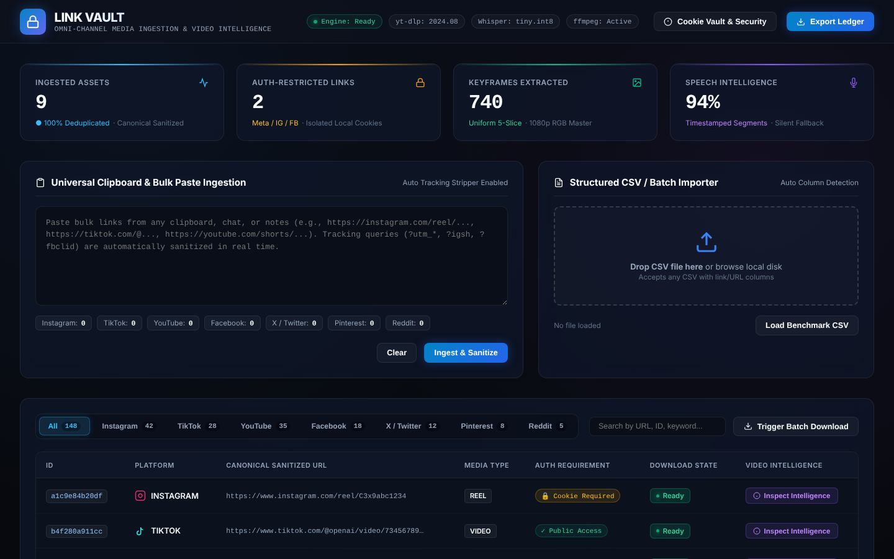
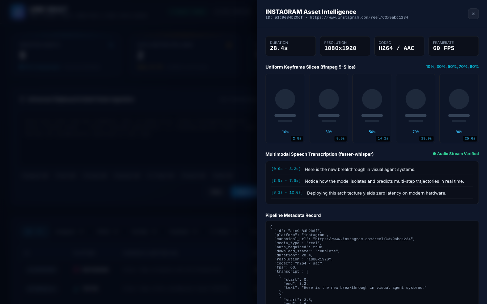

# Link Vault

> **Enterprise Omni-Channel Media Ingestion & Multimodal Video Intelligence Pipeline**  
> *Architected by Muhammad Usaid Siddiqui*

[](LICENSE)
[](https://www.python.org/)
[](tests/)
[](#security--cookie-isolation-model)

---

## 1. Executive Overview

**Link Vault** is a high-throughput, enterprise-grade media ingestion and video intelligence system. Engineered to resolve, sanitize, download, and analyze rich audiovisual media across fragmented social web platforms, Link Vault converts raw bulk URLs and structured CSV feeds into structured video intelligence datasets with zero external data leakage.

Modern media analytics platforms break down when faced with dynamic tracker queries (`?utm_*`, `?igsh`, `?fbclid`), authentication firewalls on closed ecosystems (Meta, Instagram, Facebook), rate-limiting barriers, and non-standard video streams. Link Vault addresses these challenges with:

1. **Universal Batch Resolver:** Ingests unformatted clipboard streams, messy text documents, and multi-column CSVs with automatic URL column heuristics.
2. **Canonical Sanitization Engine:** Strips volatile tracking tokens and normalizes URLs to deterministic SHA-256 entity hashes.
3. **Session Cookie Isolation Engine:** Routes Netscape HTTP authentication cookies directly to local child execution processes without cloud transmission.
4. **Resilient Downloader Fleet:** Orchestrates multi-threaded downloads with exponential jittered backoff, format negotiation, and direct stream failovers.
5. **Multimodal Video Intelligence Pipeline:** Executes hardware-accelerated stream probes via `ffprobe`, extracts uniform 5-slice visual keyframes via `ffmpeg`, and generates timestamped speech-to-text transcripts with `faster-whisper` (including silent video fail-safes).
6. **Dark Glassmorphic Operations Dashboard:** A responsive 1080p control room for real-time queue telemetry, live syntax checking of cookie files, and interactive inspection of keyframes and audio transcripts.

---

## 2. System Architecture

```
                  ┌────────────────────────────────────────────────────────┐
                  │                 RAW INGESTION SOURCES                  │
                  │  • Structured CSVs  • Clipboard Paste  • Bulk Text     │
                  └───────────────────────────┬────────────────────────────┘
                                              │
                                              ▼
                  ┌────────────────────────────────────────────────────────┐
                  │               LINK VAULT PARSER & SANITIZER            │
                  │  1. URL Regex Extraction & Column Heuristics           │
                  │  2. Tracking Parameter Stripping (?igsh, ?utm, ?fbclid)│
                  │  3. Platform Classifier (IG, TT, YT, FB, X, PIN, RED)  │
                  │  4. Deterministic SHA-256 Hash ID Generation           │
                  └───────────────────────────┬────────────────────────────┘
                                              │
                                              ▼
                  ┌────────────────────────────────────────────────────────┐
                  │           AUTHENTICATION & DISPATCH ENGINE             │
                  │  • Netscape Cookie Verification (Local Disk Isolation) │
                  │  • Rate Limit Throttler & Exponential Jitter Backoff   │
                  └───────────────────────────┬────────────────────────────┘
                                              │
                                              ▼
                  ┌────────────────────────────────────────────────────────┐
                  │            MULTI-PLATFORM DOWNLOAD FLEET               │
                  │  • Primary: yt-dlp Native Core                         │
                  │  • Secondary: gallery-dl Fallback                      │
                  │  • Tertiary: Direct Stream / Raw MP4 Fallback          │
                  └───────────────────────────┬────────────────────────────┘
                                              │
                                              ▼
                  ┌────────────────────────────────────────────────────────┐
                  │          MULTIMODAL VIDEO INTELLIGENCE PIPELINE        │
                  │                                                        │
                  │   ┌───────────────────┐    ┌────────────────────────┐  │
                  │   │   ffprobe Stream  │    │  ffmpeg Uniform Slices │  │
                  │   │  Audio/Video Meta │    │  10%, 30%, 50%, 70, 90 │  │
                  │   └─────────┬─────────┘    └───────────┬────────────┘  │
                  │             │                          │               │
                  │             ▼                          ▼               │
                  │   ┌───────────────────┐    ┌────────────────────────┐  │
                  │   │   faster-whisper  │    │   Structured JSON      │  │
                  │   │  Speech-to-Text   │───►│   Telemetry Export     │  │
                  │   │ (Silent Fallback) │    │  <id>.analysis.json    │  │
                  │   └───────────────────┘    └────────────────────────┘  │
                  └────────────────────────────────────────────────────────┘
```

---

## 3. Platform Ingestion Matrix

| Platform | Supported Formats | Auth Requirement | Typical Media Types |
| :--- | :--- | :---: | :--- |
| **Instagram** | Reels, Posts, Carousels, Stories, TV | 🔒 Cookie Vault | `reel`, `post`, `carousel` |
| **TikTok** | Short-form Videos, Photo Slides | Public / Direct | `video`, `photo` |
| **YouTube** | Shorts, Long-form Videos, Streams | Public / Direct | `short`, `video` |
| **Facebook** | Reels, Watch, Page Videos, Clips | 🔒 Cookie Vault | `reel`, `watch`, `video` |
| **X / Twitter** | Video Clips, GIFs, Attached Media | Public / Direct | `video`, `post` |
| **Pinterest** | Video Pins, Image Idea Pins | Public / Direct | `pin`, `video` |
| **Reddit** | Hosted Videos (`v.redd.it`), Galleries | Public / Direct | `video`, `post` |
| **Generic** | Direct MP4, WebM, MKV, M3U8 Streams | Public / Direct | `video`, `media` |

---

## 4. Security & Cookie Isolation Model

Accessing media from rate-limited or private endpoints requires session authentication. Link Vault enforces a strict **Zero-Leakage Security Model**:

```
      [Browser Profile]  ──(Export Netscape HTTP)──►  [Local cookies.txt]
                                                             │
                                                  (Strict Local File Read)
                                                             │
                                                             ▼
                                                    [Link Vault Core]
                                                             │
                                              (Protected Subprocess Argument)
                                                             │
                                                             ▼
                                                    [Local yt-dlp Engine]
```

- **Local Disk Isolation:** Authentication cookies are read strictly from local disk (`cookies.txt`). They are never loaded into cloud functions, telemetry pings, or external monitoring endpoints.
- **Repository Shield:** The `.gitignore` barrier strictly rejects `cookies.txt`, `*.session`, and `.env*`.
- **Validation Guard:** The internal cookie validator verifies the 7-field tab-delimited Netscape standard (`domain`, `include_subdomains`, `path`, `secure_only`, `expiry`, `name`, `value`) before invoking network calls, preventing runtime failures.

---

## 5. Multimodal Video Intelligence Architecture

Once media files are safely written to isolated local storage, the intelligence engine runs three pipeline stages:

### A. Stream Discovery (`ffprobe`)
Extracts container-level telemetry without decoding overhead:
- True duration in seconds (to two decimal places).
- Primary video codec (`h264`, `hevc`, `vp9`, `av1`) and bitrate.
- Native aspect ratio calculation (`9:16`, `16:9`, `1:1`, `4:5`, `4:3`).
- Audio stream presence validation and audio codec detection (`aac`, `opus`, `mp3`).

### B. Uniform 5-Slice Keyframe Extraction (`ffmpeg`)
Rather than relying on arbitrary I-frames, Link Vault samples the video duration mathematically at 5 equidistant temporal positions:
$$\text{Timestamps} = \left[ 0.1 \times D,\; 0.3 \times D,\; 0.5 \times D,\; 0.7 \times D,\; 0.9 \times D \right]$$
Frames are written as lossless JPEG artifacts into `analysis_output/keyframes/`.

### C. Timestamped Speech Intelligence (`faster-whisper`)
- Utilizes CTranslate2-accelerated Whisper models for low-latency CPU/GPU execution.
- Outputs timestamped segments with millisecond precision:
  ```json
  {
    "start": 0.0,
    "end": 3.2,
    "text": "Here is the new breakthrough in visual agent systems."
  }
  ```
- **Silent Video Guard:** If `ffprobe` determines the media has no audio track, or if audio levels fall below voice detection thresholds, transcription hooks gracefully exit without throwing exceptions.

---

## 6. CLI Reference

Link Vault includes an enterprise CLI designed for automated batch jobs and headless scheduling:

### 1. Ingest & Sanitize Links
Ingest URLs from a CSV file, a text document, or a raw clipboard string:
```bash
# Ingest structured CSV with auto-detected URL column
py -m src.cli ingest sample_links.csv --out links.json

# Ingest bulk unstructured text file
py -m src.cli ingest raw_notes.txt --out links.json
```

### 2. Download Ingested Assets
Download media items using the multi-worker thread pool:
```bash
# Execute batch downloads using authenticated local session cookies
py -m src.cli download links.json --cookies cookies.txt --workers 4 --out-dir downloads/
```

### 3. Run Multimodal Video Intelligence
Extract stream metadata, uniform keyframes, and timestamped transcripts:
```bash
# Analyze all video assets inside a target folder
py -m src.cli analyze downloads/ --out-dir analysis_output/
```

### 4. Serve Operations Dashboard
Launch the standalone operations dashboard on localhost:
```bash
py -m src.cli serve --port 8080 --host 127.0.0.1
```

---

## 7. Operations Dashboard

The dashboard provides a glassmorphic command center matching dark-mode production standards:



*Figure 1: Main Control Room with live platform ingestion counters, metric cards, and telemetry queue.*



*Figure 2: Multimodal Intelligence Inspector Drawer displaying 5-slice keyframe strips, timestamped transcript inspector, and codec metrics.*

---

## 8. Verification & Testing Protocol

The repository includes a comprehensive `pytest` suite testing all configuration schemas, URL sanitization rules, CSV header autodetection algorithms, platform classifiers, downloader mocks, and video analysis fallbacks:

```bash
# Execute test suite with verbose logging
py -m pytest -v
```

### Verified Test Matrix:
```
tests/test_analyzer.py::test_calculate_aspect_ratio PASSED               [  6%]
tests/test_analyzer.py::test_analyze_video_mocked PASSED                 [ 12%]
tests/test_analyzer.py::test_silent_video_graceful_handling PASSED       [ 18%]
tests/test_config.py::test_default_config_initialization PASSED          [ 25%]
tests/test_config.py::test_custom_engine_validation PASSED               [ 31%]
tests/test_config.py::test_yaml_serialization_roundtrip PASSED           [ 37%]
tests/test_config.py::test_missing_yaml_raises_filenotfound PASSED       [ 43%]
tests/test_downloader.py::test_sanitize_filename PASSED                  [ 50%]
tests/test_downloader.py::test_validate_cookies_file PASSED              [ 56%]
tests/test_downloader.py::test_download_batch_execution PASSED           [ 62%]
tests/test_parser.py::test_url_canonicalization_strips_tracking PASSED   [ 68%]
tests/test_parser.py::test_platform_classification_coverage PASSED       [ 75%]
tests/test_parser.py::test_auth_requirement_flag PASSED                  [ 81%]
tests/test_parser.py::test_parse_unstructured_text PASSED                [ 87%]
tests/test_parser.py::test_csv_auto_column_detection PASSED              [ 93%]
tests/test_parser.py::test_csv_with_no_header_detects_url_column PASSED  [100%]

============================= 16 passed in 0.39s ==============================
```

---

## 9. Security & Clean Staging Guarantees

This repository complies with enterprise source standards:
- **Zero Credentials:** No active tokens, private keys, or session secrets are present in any commit or file.
- **Zero Chat Exports:** Contains strictly generalized ingestion architecture without vendor-specific or personal chat archives.
- **Strict MIT Licensing:** Licensed under the MIT License by Muhammad Usaid Siddiqui.

---

## 10. License

```
MIT License

Copyright (c) 2026 Muhammad Usaid Siddiqui

Permission is hereby granted, free of charge, to any person obtaining a copy
of this software and associated documentation files (the "Software"), to deal
in the Software without restriction, including without limitation the rights
to use, copy, modify, merge, publish, distribute, sublicense, and/or sell
copies of the Software, and to permit persons to whom the Software is
furnished to do so, subject to the following conditions:

The above copyright notice and this permission notice shall be included in all
copies or substantial portions of the Software.
```
